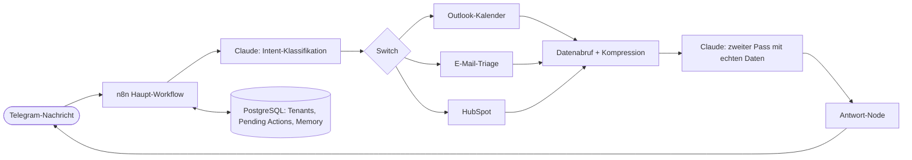

# Jonas – mein AI-Ops-Agent für Telegram

Jonas war ein Spaß- und Lernprojekt: Ich wollte wissen, wie weit man mit n8n, Postgres und einem LLM kommt, wenn man daraus einen persönlichen Assistenten baut, der den Verwaltungskram übernimmt (Kalender, Mails, CRM). Daraus wurde über einige Monate ein ziemlich ausgewachsenes System, das ich hier mit euch teilen möchte.

**Status:** eingestellt (11/2026). Als eigenes Produkt hat es sich für mich gerade nicht getragen, aber ich habe extrem viel dabei gelernt, und über Jonas sind meine ersten individuellen Kundenprojekte entstanden. Die Workflows (bereinigt, ohne Zugangsdaten) und das Datenbankschema liegen mit im Repo: [`workflows/`](workflows/) und [`database/schema.sql`](database/schema.sql).

## Was Jonas konnte

- **Kalender (Outlook):** Termine abfragen, verschieben, löschen, jeweils mit Bestätigungsschritt und Rückfrage bei mehreren Treffern
- **E-Mail-Triage:** Postfächer abfragen, kategorisieren, zusammenfassen
- **CRM (HubSpot):** Kontakte und Notizen per Chat pflegen
- **Morgen-Briefing:** automatische Tageszusammenfassung
- **Vision:** Foto oder Datei per Telegram schicken und auswerten lassen
- **Onboarding-Interview:** Jonas lernt beim Start Geschäftskontext und Vorlieben des Nutzers kennen

## Architektur

| Baustein | Umsetzung |
|---|---|
| Orchestrierung | n8n (self-hosted, Docker, Hetzner VPS) |
| Datenhaltung | PostgreSQL (Tenants, Profile, Pending Actions, Disambiguation, Locks) |
| LLM | Claude API (Haiku), über einen providerunabhängigen Sub-Workflow; Mistral als EU-Alternative vorbereitet |
| Interface | Telegram-Bot |
| Integrationen | Microsoft Graph API (Outlook), HubSpot API |
| Umfang | ca. 224 Nodes im Haupt-Setup, 45 Workflows insgesamt |

Das Datenbankschema (nur die Struktur, keine Daten) liegt unter [`database/schema.sql`](database/schema.sql).

### Ablauf einer Anfrage

### Zentrale Muster

- **Two-Pass-Pipeline:** Intent-Klassifikation → gezielter Datenabruf → Kompression → zweiter Claude-Call mit echten Daten. Der Bot antwortet über Live-Daten nie aus dem Gedächtnis.
- **Multi-Tenant:** Azure Multi-Tenant App Registration, Authorization Code Flow, verschlüsselte Refresh-Tokens pro Nutzer in Postgres, OAuth-Link-Flow zum Verbinden.
- **Pending-Action-Workflow:** schreibende Aktionen laufen über eine Tabelle mit Bestätigung, TTL und sauberem Fehlerpfad.
- **Disambiguierung:** Kandidatenlisten mit 5-Minuten-TTL in Postgres, geteilt zwischen Kalender- und CRM-Flows.
- **Lock-Mechanismus:** Postgres-Lock mit Stale-Reset für paralleles Mailbox-Polling über mehrere Tenants.
- **Loop-Schutz pro Trigger-Typ:** Rate-Limit für Telegram, eigene Schutzmechanismen für Schedules und Tool-Chaining.
- **Zentrale Fehlerbehandlung:** Error-Workflow mit Telegram-Alert (Workflow, Node, Fehlermeldung, Zeitstempel).
- **Konvergenz-Node:** alle Switch-Pfade laufen in einem Antwort-Node zusammen (`safeGet()`-Pattern gegen nicht ausgeführte Nodes).

## Learnings

- Konversationshistorie als Multi-Turn-`messages`-Array führte zu Fehlklassifikationen bei mehrdeutigen Intents. Besser: Historie als beschrifteter Textblock im System-Prompt, `messages` enthält nur die aktuelle Nachricht.
- KI-generierte Datumsangaben müssen explizit validiert werden, bevor ein `Date`-Objekt entsteht (JS normalisiert ungültige Werte stillschweigend).
- Zeitzonen sauber behandeln: Berlin-Lokalzeit gezielt nach UTC konvertieren statt auf Default-Verhalten zu vertrauen.
- `$('Node').first()` auf einen Node vor einer `SplitInBatches`-Schleife liefert für jede Iteration dasselbe Item. Das führte zu einer stillen Fehlzustellung zwischen Tenants. Werte pro Iteration immer aus einem Node beziehen, der selbst pro Iteration läuft.
- Merge-Node (Append) vor jedem Code-Node, der aus parallelen Branches gespeist wird, sonst läuft der Node mehrfach.
- Jede neue Trigger-Art braucht ihren eigenen Loop- und Rate-Schutz.
- Kosten am Worst Case kalkulieren, nicht am Durchschnitt. Reale API-Kosten lagen bei etwa 2 bis 7,50 USD pro Nutzer und Monat.

## Warum ich es eingestellt habe

Ehrlich gesagt: Es war ein tolles Projekt zum Üben, aber als eigenes Produkt hat es für mich im Moment nichts gebracht, außer laufenden Kosten für Server und API. Ich konzentriere mich jetzt auf individuelle Automatisierungen für Kunden. Die Bausteine (Telegram-Routing, Kalender-/CRM-Logik, Multi-Tenant-OAuth, LLM-Abstraktion) nehme ich dafür mit.

## Was ich mitgenommen habe

- Viel Praxis mit n8n in einem größeren Setup: Multi-Tenant-Design, OAuth, Fehlerbehandlung, LLM-Orchestrierung
- Einen Haufen Fehler, die ich nur einmal machen musste
- Meine ersten Custom-Kunden

## Kontakt

Edwin, ESWflow (AI-Automatisierung und Prozessoptimierung)
 · LinkedIn: www.linkedin.com/in/edwin-samoz

